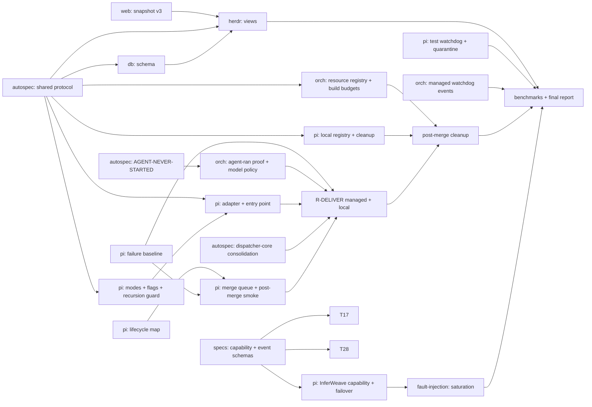

# Pi Engineering + AutoSpec + InferWeave + HerdR — Autonomous Delivery (design)

- **Date:** 2026-10-14
- **Status:** Proposed
- **Home repo:** `berlinguyinca/autospec` (this spec); work lands in the repos named per task.
- **Supersedes nothing.** Builds on, and must not redo: ADR 0002 (resilience placement), ADR 0003
  (signalled agent = terminal `SIGNALLED`, #4651), `AutoSpec_Initiative_Planning_MultiRepo_Orchestration_v2`,
  the *Pi-Engineering Mission Observability* pack (progress model, stall detection, snapshot v3) and the
  *Herdr Runtime Integration* pack (boundaries, state/events, recovery). Where those already specify a
  behavior, this spec only lists the **gap** the audit found.

This spec merges three requirement sets — the 11-workstream *Unified Master Spec* (WS0–WS10), the
*Autonomous Implementation Supervisor* brief (P0–P3), and the *Pi Engineering Autonomous Reliability
Package* (`pi_autonomy_master_spec.zip`, MASTER_SPEC v1.0 of 2026-10-10: lifecycle, operating defaults,
event contract, acceptance A1–A9, workstreams 00–08) — into one set of requirements (R-ids). Where the
sources disagree, the zip's MASTER_SPEC wins on authority and operating defaults (it is the most
specific); conflicts are listed in §2a. Duplicates are
collapsed (see §2). Every claim in §3 comes from a source audit of repo HEADs on 2026-10-14.

## 1. Goal

A user request in Pi is classified, specified (when it warrants), executed by concurrent isolated workers,
independently reviewed, locally validated, merged where policy permits, and cleaned up — with live
progress, stall recovery, model failover and disk-budgeted builds — and the operator sees it all in
**HerdR Engineering**. Pi stays fully usable alone (offline, no AutoSpec, no InferWeave, no DB).

## 2. Deduplication (one requirement, one owner)

| Topic | Master Spec | Supervisor brief | Single requirement | Owner |
|---|---|---|---|---|
| Stall / hang detection | WS8 | P0, §5 | R-WATCH | pi-engineering (local), orchestrator (managed) — one event vocabulary |
| Resource ownership + cleanup + GC | WS8 | P0, §6 | R-RES | one registry **schema** in the shared protocol; two implementers (local, managed) |
| Build-artifact bloat / caches | WS8 | P0 | R-BUILD | orchestrator (managed), pi-engineering (local) via same budget schema |
| Model routing + failover | WS5 | P2 | R-MODEL | pi-engineering client; InferWeave serves signals |
| Review → repair → merge → cleanup | WS7 | P1, §4 | R-DELIVER | pi-engineering (local), autospec (managed) |
| Parallel workers / DAG | WS6 | §2 | R-PAR | autospec (DAG, admission) + orchestrator (placement) |
| Dashboards | WS9 | P3 | R-VIEW | **HerdR Engineering only** |
| Protocol / events | WS1 | §7 | R-PROTO | autospec |
| Mode classification | WS2 | — | R-MODE | pi-engineering |
| Tools / context | WS3, WS4 | — | R-TOOLS, R-CTX | pi-engineering (+ autospec code_intel) |
| Security / rollout | WS10 | §4 | R-SEC, R-ROLL | per repo |

### 2a. Conflicts between the sources, and how they are resolved

| Conflict | Resolution |
|---|---|
| Master Spec: dual authority `pi-local` / `autospec-managed`, orchestrator + dispatcher run managed missions. Zip: **Pi Engineering is the mission, merge-queue, resource-lifecycle and recovery authority**; AutoSpec owns spec/DAG semantics "only extend where genuinely missing"; orchestrator and dispatcher are not mentioned. | Pi Engineering is the supervisor and sole lifecycle authority for a mission. `autospec-managed` stays an **optional execution backend** that Pi dispatches to (the orchestrator runs workers); it never owns a mission's merge, cleanup or recovery. No new dispatcher or merge service. |
| Master Spec lifecycle `RECEIVED→…→COMPLETE`; zip lifecycle `CREATED→PLANNED→READY→RUNNING→VALIDATING→REVIEWING→REPAIRING→MERGE_QUEUED→MERGING→MERGED→FINALIZING→ARCHIVED` + `BLOCKED/PAUSED/FAILED/CANCELLED/RECOVERING/RETAINED_FOR_DIAGNOSTICS`. | The zip lifecycle is canonical. pi-engineering already has a durable state machine (first state `NEW`, pause as stop reason); T24 maps and extends it, additively, behind a schema version. |
| Master Spec: separate telemetry in `autospec-db` and web views. Zip: HerdR is the single cockpit, "projection/analysis/control interface, not a second scheduler". | HerdR Engineering only (already §4.4). |
| Master Spec: reviewer independence by (model, endpoint). Zip: "implementing model cannot solely approve its own work". | By model **family**, stronger than both. |
| Brief: "avoid optional external CI as a blocker". Zip: same plus mandatory protections stay mandatory. | Identical; required checks block, optional CI does not. |
| Master Spec: InferWeave client-side fallback only. Zip: Pi sends capability, quality floor, min context, modality, deadline, affinity, open-weight constraint; **InferWeave returns eligible model/slot, estimated wait and route reasons**. | Estimated wait and route reasons are required, so the gateway work (T17) is **not optional** and the contract lives in `inferweave-specs` (T27). |
| Brief: unlimited parallelism "as capacity allows". Zip: bounded by model slots, CPU/RAM/disk, build capacity, merge queue. | The zip's bounds. |

Dropped as duplicate or already satisfied: a second dispatcher binary; a second dashboard in Pi
Engineering; a second model router; a new mission state machine (exists); new stall detector in
pi-engineering (exists, `resilience-watchdog`).

## 3. Audit baseline (what exists)

`EX` existing, `PA` partial, `MI` missing, `CO` conflicting. Sources are file paths at the audited HEADs
(pi-engineering 0b3e79e, autospec 09d7070, autospec-orchestrator 1618a96, autospec-db e74c6ec,
pi-engineering-web 7464950, autospec-dispatcher 21b43b4, autospec-gui 12ce541, InferWeave main 3c05f3db).

- **pi-engineering:** mission state machine EX (`src/orchestration/state.ts`; first state is NEW, no
  RECEIVED; pause is a stop reason, not a state); ownership leases with monotonic fencing token EX but
  **session-scoped** (`ownership.ts:194,254,358`); routing/fallback/circuit breaker EX (~100 tests); stall
  and heartbeat EX (`resilience-watchdog`); intent router PA (regex, 12 intents → 10 classes, no
  autospec/mission mode, no `PI_AUTOSPEC_*` flags); `AutoSpecAdapter` seam CO (`Adapters.ts:12`, unused,
  wrong direction); no external submit/cancel entry point MI; recursion guard structural only PA
  (`PiWorkerExecutor.ts:105`); Verifier has **no failure baseline** MI (`Verifier.ts`); tool registry PA
  (7 tools); ContextBroker has no cache PA; cleanup PA, **no owned-resource registry** MI.
  `npm test` incomplete at audit time (timeout; 2 failures unconfirmed — treat as unverified).
- **pi-engineering-web ↔ runtime:** runtime publishes snapshot `contractVersion = 3`
  (`missionSnapshot.ts:17`); web accepts only 1–2 and **rejects 3** (`index.ts:94`) → panel shows an
  error. CO.
- **autospec:** spec/DAG/criteria/traceability EX; code-intel interface EX but backend always errors
  (`backend/agent_lsp.rs:136`) PA; RAG only test doubles PA; locks/claims EX (`issue_lock.rs`,
  `claim/`); collision handling is reactive not predictive PA; three DAG models, three lease types, two
  task lifecycles, three separation-of-duty implementations CO; 0-byte run still `NO-OUTPUT`, no
  `AGENT-NEVER-STARTED` CO (SIGNALLED already done by #4651); no HTTP API, no version negotiation, no
  sequence on the Initiative audit log MI.
- **autospec-dispatcher:** a stub binary (`main.rs` exits 2) plus `dispatcher-core` three-reviewer panel
  (≥2 approvals, any reject blocks, UNKNOWN never approves) EX; reviewer independence compares
  (model, endpoint) so the same model on another endpoint passes PA; the rest of the dispatcher design is
  prose. ADR 0002 says "dispatch judgement stays in the dispatcher" but the code lives in autospec CO.
- **autospec-orchestrator:** worktree ownership and owned-only cleanup EX (tampered-owner refusal tested);
  crash recovery, durable cancellation, CPU/mem/PID/rootfs limits EX; health timers 900 s / 4 h / 1 h EX;
  per-execution disk quota only via LVM/APFS PA; placement ignores arch and toolchain versions PA; fencing
  is per attempt id, one shared worker bearer token PA; **model policy never passed to Pi** (no
  `--model/--provider`) CO; `agent_settled` with zero assistant turns, or an empty diff, counts as
  review-ready CO; no recursion prevention, no `CARGO_TARGET_DIR`/cache/GC, no event emission to
  autospec-db, no mission/task/model/token schema MI; containers run as root on a non-internal network
  with no `cap_drop`/`no-new-privileges` PA.
- **Pi versions:** adapter targets Pi 0.84.3, pi-engineering requires ≥0.87.0 (`minimumPiVersion`).
  Tested 0.84.3, 0.87.0, 0.87.1: every flag the adapter passes works in all three; session
  start/resume/fork identical; exit code is **not evidence** (provider 500 or unreachable → exit 0 with
  `stopReason:"error"`; missing key → exit 1, no session file). 0.85–0.86 and real tool execution untested.
- **autospec-db / autospec-gui:** db is one `events_raw` jsonb table + views, non-authoritative by design,
  no model/token/mission columns; GUI reads table names that db does not have (renders empty); GUI never
  calls the orchestrator. CO.
- **InferWeave:** capability routing via `cap:` model strings / `x-inferweave-*` headers PA (only when
  routes are configured); busy signalling (`Retry-After`, `x_availability`, `x_fallback_candidates`) EX;
  cache affinity via `x-inferweave-session` EX; latency/cost fields, queue position, client-readable
  usage MI. pi-engineering already sends capability headers and honours `Retry-After`; its capability
  vocabulary (`tool_calling`, `fast`, `low_cost`) does not match the gateway's (`tool_use`,
  `coding.*`), it ignores `x_capabilities/x_family/x_tools`, sends no session header, and
  `src/cav/routing.ts` hard-codes legacy model names.
- **HerdR Engineering** (`herdr-engineering` 2fccc00; a thin layer over upstream herdr, not a fork;
  pytest 274 passed / 1 skipped, plugin `node --test` 32 passed): SPA routes for overview, missions,
  `missions/:id`, sessions, services, hosts, analytics EX (`packages/app.js:54-68`); `POST
  /api/v1/ingest` `{entity_type, entity_id, event_type, payload}` idempotent and redacted EX
  (`control_plane/ingest.py:19-45`); activity-event contract with `source` enum incl. pi-engineering and
  autospec and mission/issue/worktree/CI correlation fields EX (`docs/contracts/activity-event.md`); SSE
  stream EX (`api.py:297`); viewer/operator API-key roles, fail-closed bind EX (`api.py:84-195`);
  `pi_autospec.py` typed adapters/correlator, in-memory only, nothing feeds them PA; build/test pages PA
  (legacy `web.py` only, none in the SPA); review and merge pages MI (tables `reviews`,
  `review_findings`, `pull_requests` exist in `0001_control_plane.sql:287-306`, unused); stall age,
  progress, recovery actions MI; `token_usage`/`resource_usage` tables unused PA; snapshot v3 reader MI
  (zero hits for `contractVersion`, `.pi-eng`, `autospec-db`); InferWeave/gateway telemetry MI; per-stage
  duration and bottleneck attribution MI; `herdr-cp-feed-plugin` maps herdr workspace→mission and
  pane→session, so a Pi mission id and a herdr workspace id can collide in `missions` CO.

## 4. Authority decisions (ADR content)

1. **Pi Engineering is the supervisor and sole authority** for mission lifecycle, the serialized merge
   queue, resource ownership/cleanup and recovery. Each task has exactly one *executor*: `pi-local` or
   `autospec-managed`; switching executor needs quiescence, durable reconciliation and a fresh fencing
   epoch, and an expired lease alone never authorizes a second mutator. AutoSpec owns spec, task ids,
   dependencies and status integration.
2. **No new dispatcher or merge service.** The `autospec-dispatcher` repo becomes a library
   (`dispatcher-core`: reviewer panel, independence policy) used by whoever reviews; the stub binary is
   removed; ADR 0002's sentence ("dispatch judgement stays in the dispatcher") is corrected. AutoSpec's own
   `/autospec-run` loop keeps merging AutoSpec issues; a Pi mission is only ever merged by Pi's queue.
3. **`autospec-orchestrator` is the optional managed executor** (worker/worktree/container lifecycle for the
   `autospec-managed` backend); `pi-engineering` is the interactive controller and supervisor.
   Self-hosted/open-weight models only for product inference — no proprietary cloud fallback.
4. **Operator UI = HerdR Engineering.** `pi-engineering-web` stays a thin in-Pi panel over the same
   snapshot (fix v3). `autospec-gui` gets no new features; it is fixed to the db schema or frozen.
5. **`autospec-db` is telemetry only.** Never authoritative.
6. **Canonical model = Initiative DAG** (`initiative/dag.rs`); the other DAG/lease/lifecycle types get
   adapters and a deprecation note, not a rewrite, in this effort.
7. **Required checks block; optional CI does not.** Local validation may precede CI but never replaces a
   required remote check or branch protection.

## 5. Requirements

Each R-id lists repo, reuse, and what is new. P0 first; independent items run in parallel.

### P0 — immediate reliability
- **R-WATCH (stall recovery).** Pi local watchdog exists. Add: (a) managed side emits the same event
  vocabulary with current command, last meaningful progress, CPU/RSS/disk sample; (b) a quiet but healthy
  process (CPU or I/O progressing) extends its deadline, a flat one does not; (c) bounded recovery
  ladder; (d) `AGENT-NEVER-STARTED`: an execution with exit 0, no session record and zero assistant turns
  is a failure, not `NO-OUTPUT` and not review-ready. *Repos:* autospec-orchestrator, autospec, pi-engineering.
- **R-RES (resource registry).** One versioned `ResourceRecord` schema (kind: worktree, process, build_dir,
  cache, container, temp_file; owner mission/execution; created; lease; state). Local and managed
  implementers write it; GC acts only on records it owns and never on active-mission or foreign
  resources; operations idempotent; crash-safe reconcile. Reuse `git-worktree/src/{manager,cleanup}.rs`
  and pi-engineering journaled branch cleanup. *Repos:* autospec (schema), autospec-orchestrator, pi-engineering.
- **R-BUILD (Rust bloat).** Per-mission `CARGO_TARGET_DIR`, a shared compile cache (sccache or equivalent)
  keyed by toolchain+lockfile, disk budget per mission and per host, pressure GC of unreferenced owned
  caches, pinned toolchains. Incompatible mutable build output is never shared. *Repos:* autospec-orchestrator, pi-engineering.
- **R-PROTO-0 (snapshot v3).** `pi-engineering-web` accepts v3 and a shared golden fixture is asserted by
  both repos' tests. *Repo:* pi-engineering-web (+ fixture in pi-engineering).

- **R-WATCH defaults (from the zip, adjustable per machine).** Test silence warning 2 min; progress
  investigation 5 min; confirmed-stall recovery target 10 min; command wall timeout 30 min unless tagged
  long-running with an explicit deadline. CPU use alone is not progress; detect child processes, I/O wait,
  blocked test cases, deadlocks, queue waits and starvation. Capture bounded evidence (process tree, last
  output) before killing an owned process group. Two identical stalls quarantine the test and block the
  merges it affects — quarantine is never a false green. Test runner: structured events, `cargo-nextest`
  where compatible plus doctests; selective tests while iterating, policy-defined full verification at
  merge. Cache results by source/dependency/compiler/flags/environment fingerprint; no reuse across a
  changed base without integration proof. Heartbeat is never proof of progress.
- **R-BUILD defaults.** sccache shared by compatible builds, bounded to 40 GiB by default; separate
  `target/` per mission when Cargo locking or features require it, with an initial 100 GiB target budget;
  build concurrency and per-mission quotas; incremental builds off where beneficial. A cache does not
  bound `target/`. Disk: warn at 80 % used; stop admitting new builds at 90 % used or below the free-space
  reserve; quotas count bytes **and inodes**; reclaim only eligible artifacts. Retention: failure
  artifacts 24 h, logs 7 d, shared cache LRU.
- **R-LIFE (mission lifecycle).** Canonical states: `CREATED→PLANNED→READY→RUNNING→VALIDATING→REVIEWING→
  REPAIRING (bounded)→MERGE_QUEUED→MERGING→MERGED→FINALIZING→ARCHIVED`, plus `BLOCKED, PAUSED, FAILED,
  CANCELLED, RECOVERING, RETAINED_FOR_DIAGNOSTICS`. Every transition is durable, versioned, idempotent,
  authorized, event-emitting and fenced by generation/lease; it records reason, timestamp, owner,
  attempts, commit SHA, PR, worker and worktree ids. A mission is `ARCHIVED` only when required cleanup
  succeeded or a retention exception is recorded. A mission is never marked complete on agent assertion
  alone. *Repo:* pi-engineering (map onto the existing machine, additive schema version).
- **R-EVENT (observability contract).** Every mission/worker/build/test/review/merge/cleanup/routing event
  carries: `schema_version, event_id, trace_id, mission_id, task_id, worker_id, host_id, repository,
  worktree_id, commit_sha, operation_id, event_type, state, timestamp, sequence (monotonic),
  causal_parent_id, human_summary, progress_kind, last_progress_at, deadline_at, resource_usage`, and
  artifact refs where applicable. Optional fields are typed and never invented. Delivery at-least-once,
  consumers idempotent, replay checkpoints. Credentials and private prompts redacted; no hidden
  reasoning. Live heartbeat and useful progress are separate fields. Contract lives in
  `inferweave-specs`/autospec protocol (R-PROTO) with golden fixtures. *Repo:* autospec (schema).
- **R-MERGEQ (merge queue).** Serialized per target branch; review and validation bound to the exact
  head SHA and the current integration base; stale SHA or conflict triggers rebase and revalidation;
  mandatory GitHub checks and approvals honored; post-merge smoke verification and policy-governed revert
  on an attributable regression. *Repo:* pi-engineering.

### P1 — autonomous delivery
- **R-PROTO (shared protocol).** Versioned JSON Schema for Mission, Task, Execution, Worker, Event,
  ResourceRecord, Checkpoint, Lease, Budget; idempotency keys; monotonic per-mission event sequence;
  version negotiation; unknown required fields fail closed; generated Rust and TS types; golden
  fixtures run by both toolchains. Seeds: `autospec.implementation-handoff.v1`, work-receipt,
  evaluation-journal `sequence`. *Repo:* autospec.
- **R-MODE (classification).** Add `autospec` and `mission` modes to the existing intent router
  (deterministic first; LLM only for consequential ambiguity), `--mode/--backend/--budget/--max-workers`,
  flags `PI_AUTOSPEC_ENABLED`, `PI_AUTOSPEC_MANAGED_ENABLED`, `PI_AUTOSPEC_AUTO_CLASSIFY`, default off;
  entry state is `CREATED` (R-LIFE, T24); recursion guard (`PI_MISSION_DEPTH` env + refusal when >0 for root missions).
  *Repo:* pi-engineering.
- **R-ADAPT (adapter + entry point).** Replace the dead `AutoSpecAdapter` with `submit/observe/cancel`;
  implement `WorkerExecutor` and `VerificationProvider` adapters for AutoSpec; external entry point
  (CLI/JSON) with owner identity usable under fencing. Optional and default-off. *Repo:* pi-engineering, autospec.
- **R-DELIVER (review → merge → cleanup).** Independent review by a different model *family* and a fresh
  context (reviewer independence compared on family, not endpoint); bounded automatic repair;
  verification with **failure baseline** (pre-change vs post-change; introduced failures block;
  pre-existing do not) tied to base SHA, stale evidence invalidated; merge when branch protection and
  required checks permit; conflict reconciliation and interrupted-operation recovery; after merge: persist
  evidence, stop owned processes, remove only owned worktree/branch/caches, release leases. One
  separation-of-duty implementation (dispatcher-core). *Repos:* pi-engineering (Verifier baseline,
  local), autospec + autospec-dispatcher (managed, SoD consolidation).
- **R-PAR (parallel execution).** AutoSpec DAG supplies dependencies; admission and exclusive locks for
  wide changes; predictive collision from affected files/symbols before dispatch (reactive handling kept);
  placement honours arch and toolchain version; concurrency adapts to model slots and disk.
  *Repos:* autospec, autospec-orchestrator.
- **R-ORCH (orchestrator correctness).** Pass model policy to Pi (`--model/--provider`); Pi version
  pin/check against a tested matrix (0.84.3 / 0.87.0 / 0.87.1 pass; 0.85–0.86 to be tested); per-worker
  credentials replacing the shared bearer token; non-root, `cap_drop=ALL`, `no-new-privileges`, internal
  network by default. *Repo:* autospec-orchestrator.

### P2 — model availability
- **R-MODEL request/response contract (from the zip).** Pi sends: task capability, quality floor, minimum
  context, modality, latency/deadline, affinity, and the open-weight/self-hosted constraint. InferWeave
  returns: eligible model and slot, **estimated wait**, and route reasons. No eligible capacity is an
  explicit `BLOCKED` with a bounded wait, never an infinite retry; a quality floor is never weakened to
  win a slot; side-effecting tool calls are never replayed blindly after a switch; context is rehydrated
  at a safe checkpoint. Schemas and contract tests live in `inferweave-specs`; the gateway
  (`metabolomics-us/inferweave-gateway`) stays a thin relay/admin UI with no scheduling role.
- **R-MODEL.** Map Pi capability names to the gateway's (`tool_calling→tool_use`, …); read
  `x_capabilities/x_family/x_tools`; send `x-inferweave-session`; resolve canonical model ids (no
  hard-coded legacy names); bounded fallback across *qualified* models only (tool-calling and context
  qualified; deepseek-v4.1-flash is excluded until #538 is fixed); hysteresis so a model is not
  re-selected inside a cool-down; never replay a request after tool execution began unless
  `replay_safe`; preserve task state across the switch; honour `Retry-After` with jitter; no infinite
  retry and no silent capability downgrade. *Repo:* pi-engineering. InferWeave optional additions (reasoning
  flag in `/v1/models`, queue position, client-readable usage) are P2-late, *Repo:* inferweave.

### P3 — HerdR Engineering
- **R-VIEW.** Extend HerdR Engineering's mission and test views from the shared snapshot/events:
  active missions, agents, builds, tests, reviews, merges, stall age, recovery actions, model/gateway,
  worktree and disk; correlation by mission/execution id; historical performance and bottleneck
  analysis. Read-only; mutations go through authenticated controller APIs. Build on the existing ingest
  endpoint, `ActivityEvent`, SSE stream, viewer/operator roles and `pi_autospec.py` adapters; new work is
  (a) a snapshot-v3 / protocol-event reader that posts to `/api/v1/ingest` under an ingest-capable role,
  (b) a collision rule so Pi mission ids and herdr workspace ids never share a `missions` row,
  (c) stall age / progress / recovery-action fields, (d) build, test, review and merge pages using the
  existing unused tables, (e) per-stage duration and bottleneck analytics, (f) use `token_usage` and
  `resource_usage`. HerdR becomes the only place that parses snapshot v3 besides the Pi panel.
  *Repos:* herdr-engineering; autospec-db schema columns (model, tokens, mission/task); autospec-gui fixed
  or frozen.

### Cross-cutting
- **R-SEC.** Least-privilege tool allowlists, authenticated APIs, redaction, audit trail; source and model
  output are untrusted input.
- **R-ROLL.** Local adapter → managed backend → automatic classification; rollback to standalone Pi.
- **R-DOC.** `docs/integration/final-report.md` (implemented/partial/missing matrix, PR links, SHAs,
  measured deltas, blockers).

## 6. Task DAG (cross-repo)

| Task | Repo | Reqs | Needs |
|---|---|---|---|
| T01 accept snapshot v3 + shared golden fixture | pi-engineering-web | R-PROTO-0 | — |
| T02 Verifier failure baseline | pi-engineering | R-DELIVER | — |
| T03 agent-ran proof, model policy to Pi, Pi version pin | autospec-orchestrator | R-WATCH, R-ORCH | T04 |
| T04 `AGENT-NEVER-STARTED` vs `NO-OUTPUT` | autospec | R-WATCH | — |
| T05 resource registry, build budgets, GC | autospec-orchestrator | R-RES, R-BUILD | T08 |
| T06 local registry, cleanup, build budgets | pi-engineering | R-RES, R-BUILD | T08 |
| T07 managed watchdog events (progress-based) | autospec-orchestrator | R-WATCH | T08 |
| T08 shared protocol + fixtures | autospec | R-PROTO | — |
| T09 ADR: authority, dispatcher placement; fix ADR 0002 | autospec | §4 | — |
| T10 modes, flags, recursion guard | pi-engineering | R-MODE | T08 |
| T11 adapter + external entry point | pi-engineering | R-ADAPT | T10 |
| T12 dispatcher-core: family independence, SoD consolidation, drop stub | autospec-dispatcher + autospec | R-DELIVER | T09 |
| T13 predictive collision + placement by arch/toolchain | autospec, autospec-orchestrator | R-PAR | T08 |
| T14 review→repair→merge flow, conflict + interrupt recovery | autospec, pi-engineering | R-DELIVER | T02,T03,T11,T12 |
| T15 post-merge cleanup of owned resources | both | R-RES | T05,T06,T14 |
| T16 InferWeave capability mapping + qualified failover, BLOCKED on no capacity | pi-engineering | R-MODEL | T27 |
| T17 InferWeave: eligible model/slot, **estimated wait**, route reasons, reasoning flag, usage | inferweave | R-MODEL | T27 |
| T18 saturation fault-injection test | pi-engineering | R-MODEL | T16 |
| T19 HerdR mission/test views from snapshot+events | herdr-engineering | R-VIEW | T01,T08,T20 |
| T20 autospec-db model/token/mission columns; GUI fix or freeze | autospec-db, autospec-gui | R-VIEW | T08 |
| T21 orchestrator hardening (non-root, caps, per-worker token) | autospec-orchestrator | R-SEC | — |
| T22 unify DAG/lease/lifecycle behind adapters + deprecation | autospec | §4.6 | T09 |
| T24 map zip lifecycle onto the existing mission state machine (additive, versioned) | pi-engineering | R-LIFE | T08 |
| T25 test watchdog: per-test progress, process tree, evidence, quarantine, nextest, result cache | pi-engineering | R-WATCH | T08 |
| T26 serialized SHA-fenced merge queue, post-merge smoke and revert | pi-engineering | R-MERGEQ | T02,T24 |
| T27 capability request / routing decision / event schemas + contract tests | inferweave-specs | R-MODEL, R-EVENT | — |
| T28 gateway compatibility check (thin relay, no scheduler); fix only if broken | metabolomics-us/inferweave-gateway | R-MODEL | T27 |
| T29 `AUDIT.md`, `CONTRACT_GAPS.md`, `IMPLEMENTATION_STATUS.md` deliverables | pi-engineering | R-DOC | — |
| T23 benchmarks, chaos run (A1–A9), final report, rollback docs | autospec + pi-engineering | R-DOC | all |

## 7. Acceptance (merged, deduplicated)

1. A simple Pi task completes offline with AutoSpec, InferWeave and DB absent.
2. A complex request creates or reuses an AutoSpec spec and DAG; amendments replan only affected nodes.
3. Managed execution launches Pi through `harness-pi` with the model policy actually passed.
4. Two authorities never mutate one task, including across restart and lease expiry (fault injection).
5. Pause / cancel / resume / supervisor restart preserve work and ownership.
6. An execution with exit 0 and no session or no assistant turns is reported `AGENT-NEVER-STARTED`.
7. Reviewer independence is by model family; UNKNOWN is never approval; stale evidence is rejected;
   pre-existing failures do not block, introduced failures do.
8. Required checks and branch protection are never bypassed; optional external CI never blocks.
9. Gateway saturation triggers bounded fallback to a qualified model; no thrash, no duplicate tool
   execution, no infinite wait.
10. A silent hung test is detected and recovered or visibly blocked; a quiet healthy build is not killed.
11. Rust build output stays inside the configured budget under concurrent missions; pressure GC removes
    only owned, unreferenced caches.
12. After a merged PR, owned worktree, branch, processes and caches are removed; foreign and
    active-mission resources are untouched.
13. HerdR Engineering shows live mission/agent/build/test/review/merge state with stall age and recovery
    actions, correlated by mission id, without taking control authority.
14. Rust and TS contract tests plus the Pi version matrix pass; `pi-engineering-web` accepts v3.
15. Existing Pi, AutoSpec and InferWeave behavior stays compatible; standalone mode is unchanged.

Zip acceptance A1–A9 are mandatory and map to the list above: A1 hanging 8 h Rust test detected in
minutes with last progress and process tree (items 10); A2 overnight 20-worker build storm stays inside
budgets with measurable cache reuse and no Cargo lock convoy (11); A3 merge triggers idempotent,
restart-safe cleanup that loses no dirty work (12); A4 model/gateway capacity failure switches to a
qualified model without thrash or duplicate tool effects, else bounded `BLOCKED` (9); A5 concurrent PRs
revalidate on stale SHA, protections honored, optional CI does not hold progress (7, 8); A6 supervisor
killed mid review/merge/cleanup resumes without duplicate merge or unsafe deletion (4, 5); A7 HerdR shows
live state and historical replay after restart, missing telemetry labelled unknown/stale (13); A8
mixed-repo mission correlated end to end, dependencies unblock only after verified gates (2, 7); A9 faults
in disk, permissions, test runner, GitHub, inference and network yield bounded retries, diagnostics and
safe pause. T23 runs these as fault-injection tests and a 20-agent stress run.

Benchmarks (T23): identical task set (trivial fix, medium feature, complex Rust change, multi-repo
contract, failing test, gateway busy, stale CI, patch collision, crash, long test) against the standalone
baseline; p50/p95 time-to-verified, tokens, retries, disk, success. Thresholds come from measured
baselines, not invented percentages.

## 8. Epistemic gates (apply to every task)

1. Name the producer of every value a gate reads, and verify it is current and complete.
2. A "pass" names its inputs, revision and scope.
3. Re-baseline immediately before judging.
4. Shared inputs are declared shared state; all consumers read the same instance.
5. Limits derive from the real budget they protect, never from observed history.

## 9. Team

- **Team:** Reliability/backend — backend developer, platform engineer, SRE, database engineer,
  security advisor (+ an architect for the protocol).
- **Review counter-team:** security, operations, data-integrity — challenges lease/fencing races,
  cleanup of foreign resources, credential scope, and anything that treats exit code as proof.

## 10. Out of scope / open items

- No second dashboard, dispatcher, router, or mission state machine.
- `pi_autonomy_master_spec.zip` was read in full (MASTER_SPEC.md plus workstreams 00–08, whose bodies
  are one shared boilerplate paragraph); `SUPERVISOR_PROMPT.md` is the same brief that was pasted.
- pi-engineering's full test suite was not verified green at audit time.
- Pi 0.85–0.86 and real model tool execution untested in the version matrix (done in T03).
- Cross-repo deps are recorded in this spec and the umbrella checklist; per-repo `autospec-run` handles
  one repo at a time, so tasks run in dependency tiers.

> AUTONOMOUS ASSUMPTION: HerdR Engineering (not pi-engineering-web, not autospec-gui) is the single
> operator dashboard; the brief says so explicitly.
> AUTONOMOUS ASSUMPTION: the dispatcher repo becomes a library rather than a service, because the
> dispatch code already lives in autospec and a second service would be the duplicate the brief forbids.
> AUTONOMOUS ASSUMPTION: InferWeave gateway additions (T17) are optional and last; the client-side
> mapping (T16) delivers the failover requirement alone.

Mermaid: DAG above; no other diagram needed.
