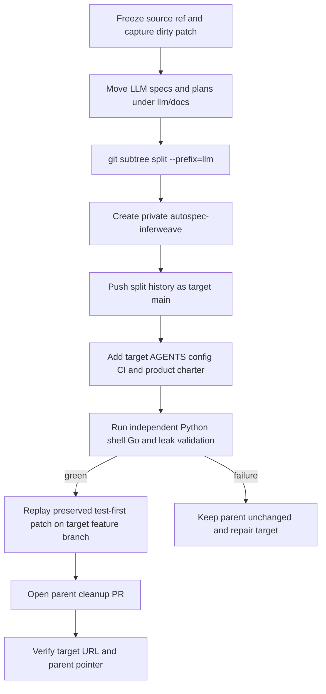

# Autospec InferWeave repository extraction design

## Goal

Move the complete, decoupled LLM product and its history from `berlinguyinca/autospec` into a private `berlinguyinca/autospec-inferweave` repository, prove the extracted repository can build and test independently, then remove the duplicate source tree and obsolete parent-repository CI/docs references.

## Feature profile

`ordinary`. This stage moves source and documentation without changing authentication, databases, node control, or production hosts. Those security/database changes are designed and decomposed after the target repository exists.

## Evidence

- Verified: `llm/` sources no parent Autospec runtime libraries; the coupling is parent-to-child through documentation and one CI job.
- Verified: the source history contains 125 commits touching `llm/`, 82 of which touch only `llm/` on the inspected ref.
- Verified: `.github/workflows/python.yml` owns the current node checks; `AGENTS.md` owns the parent pointer.
- Verified: the private destination repository does not exist as of 2026-08-20, and the authenticated `berlinguyinca` account can create it.
- Verified: five test-first catalog/residency files contain an uncommitted 225-line patch in `/tmp/wt-llm-operations`; it must be preserved and replayed in the target repository after extraction.

## Team personality

**Selected team: repository migration and release engineering.** Roles: git/history specialist, build engineer, Python/Go test maintainer, documentation owner, and security reviewer. The team emphasizes byte identity, recoverability, provenance, and never deleting the source before the target proves itself.

### Review counter-team

**Counter-team: disaster recovery and consumer compatibility.** Roles: recovery operator, CI reviewer, package/layout reviewer, and secret-leak reviewer. It challenges history loss, missing runtime files, broken relative paths, hidden uncommitted work, and source deletion before independent validation.

## Scope

### Moves to the target

- Every tracked file under `llm/` from the extraction source ref.
- LLM-specific design specs and implementation plans currently under `docs/superpowers/{specs,plans}`.
- Node CI logic currently embedded in the parent Python workflow.
- A new target-root `AGENTS.md`, `.autospec/autospec.yml`, GitHub workflows, `DESIGN.md`, security policy, and repository README.

Before the split, related external documents move under `llm/docs/specs` and `llm/docs/plans` in one mechanical commit so `git subtree split --prefix=llm` carries their history. After the split, the `llm/` prefix disappears naturally and node directories sit at the target root.

### Stays in Autospec

- Autospec CLI, skills, runtime, hooks, schemas, and tests.
- `docs/memory/`, because it is cross-project operator memory.
- Generic test fixtures whose sample text merely mentions `llm/`.
- A short `AGENTS.md` and README pointer to `https://github.com/berlinguyinca/autospec-inferweave`.

### Removed from Autospec only after proof

- The tracked `llm/` tree on the parent default branch.
- The node-specific workflow steps.
- Moved LLM specs/plans and stale internal links.

## Migration sequence



### Exact safety order

1. Record the source commit, complete worktree list, dirty file list, and patch hash.
2. Rehome every LLM-specific spec/plan into `llm/docs` without rewriting content.
3. Commit the document move on `feat/extract-autospec-inferweave`.
4. Run `git subtree split --prefix=llm` from that immutable commit.
5. Create `berlinguyinca/autospec-inferweave` with `--private` and push the split ref as `main`.
6. Clone the target into a fresh worktree and verify tracked file lists and SHA-256 content hashes against the source subtree at the split commit.
7. Add repository-native configuration and CI in a new target commit; do not rewrite split history.
8. Run target tests from target paths, including clean-install file-presence validation.
9. Replay the preserved uncommitted test patch on a target feature branch and continue its Autospec application work there.
10. Only after target validation is green, open a parent-repository cleanup PR against `main`.

## Target layout

```text
AGENTS.md
DESIGN.md
README.md
.autospec/autospec.yml
.github/workflows/
docs/specs/
docs/plans/
linux-turing-dual/
linux-qwen38/
agent/
QWEN-NODE-SPEC.md
```

The subsequent Angular and control-plane application may add `apps/web`, `apps/control-plane`, `packages/contracts`, and database migrations. Extraction does not pre-create empty architecture beyond the minimum repository/CI contract.

## Error handling and recovery

- If repository creation or push fails, the parent remains unchanged and the split ref stays local and recoverable.
- If file/hash equality fails, no cleanup begins; repair the split procedure and regenerate from the same immutable source commit.
- If target tests fail because of path assumptions or missing shipped files, fix the target in additive commits and rerun the complete target suite.
- If the target remote already appears during a retry, verify its visibility, default branch, and immutable split marker before adopting it; never overwrite an unrelated repository.
- If the parent cleanup PR fails validation, keep both copies temporarily and label the target authoritative; never force-delete or force-push.
- The dirty catalog/residency patch remains in its source worktree until its target replay commit exists and tests show the same intended failures.

## Testing

### Target independent validation

- Joint Python test collection for both node suites with `-p no:cacheprovider`.
- Both structural shell suites, shell syntax checks, and clean-install runtime-import/file-presence checks.
- Go agent `go test ./...`, `go vet ./...`, and supported cross-builds.
- Leak scan for forbidden host/site identifiers and credentials.
- Installer/config smoke tests from the new root layout.
- Hash equality script comparing the pre-split subtree to target `main` before target-only scaffold commits.

### Parent cleanup validation

- `cargo test --workspace --no-fail-fast`.
- `autospec validate` and repository shell validation.
- A link check proving every removed LLM path is replaced by the target repository URL.
- A negative check proving no node CI command still references `llm/`.

## Documentation visualization

The migration flow above is the required Mermaid control-flow diagram. The target product charter contains the application boundary; subsequent target specs add architecture, sequence, state, and trust-boundary diagrams.

## Acceptance criteria

1. `gh repo view berlinguyinca/autospec-inferweave` reports `PRIVATE` and default branch `main`.
2. The split history retains LLM commit subjects and authors; at least one measured-node commit is traceable in the target log.
3. Pre-split and target tracked files are byte-identical before target-only scaffold commits.
4. Every LLM-specific spec and plan is reachable under target `docs/`; no authoritative copy remains in Autospec after cleanup.
5. Target Python, structural shell, Go, install-completeness, and leak suites pass from target-root paths.
6. The 225-line dirty test patch is preserved until it is replayed on a target feature branch.
7. Autospec `AGENTS.md` points to the private target and contains no claim that node sources remain local.
8. Autospec CI contains no node-specific job or `llm/` path.
9. No source deletion, force-push, history rewrite, or target overwrite occurs.
10. The target product charter is tracked at `docs/specs/2026-08-20-autospec-inferweave-product-charter.md`.

## Out of scope

- Angular, Fastify, PostgreSQL migration, MCP, model delivery, or InferWeave protocol implementation.
- Production node deployment changes.
- Publishing the private repository or moving cross-project `docs/memory`.
- Rewriting the extracted history to change paths retroactively.
